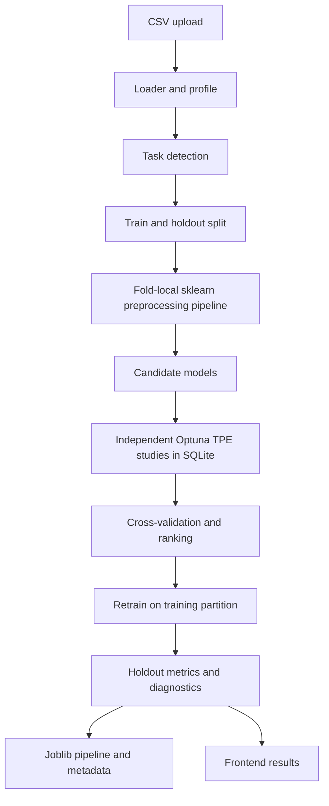

# Architecture and methodology

The active application is `backend/app/`: it contains the AutoML engine and the FastAPI API. `frontend/` is the React/Vite client. The root `app/` package is a legacy duplicate and is not imported by the backend or the current tests.

For supervised tabular tasks, data is split before tuning, and complete sklearn pipelines are evaluated in CV so learned preprocessing is fit within each training fold. The holdout partition is reserved for final evaluation. Classification uses stratified folds; regression errors are represented as positive values and minimized. Optuna studies are independently named per dataset, task, metric, and model and persist in `experiments/optuna_studies.db` by default.

Clustering is assessed with intrinsic cluster diagnostics, not accuracy. Unlabeled anomaly detection reports detected ratio, score distribution, and resampling stability; those values are diagnostics, not ground-truth performance. The separate `/api/forecast/run` workflow adds fixed-origin direct horizon forecasts with target lags, rolling statistics, Optuna Ridge tuning, expanding `TimeSeriesSplit`, and a naive baseline. Its fixed-origin predictions use only history available at the forecast origin.

## Capability status

- Implemented: tabular classification/regression, preprocessing pipelines, Optuna optimization, holdout evaluation, clustering, unlabeled anomaly diagnostics, model export, API training jobs, frontend result panels.
- Partial: optional SHAP/LIME paths (dependencies are optional and absent from the current runtime), full AutoMLEngine time-series model family, fairness diagnostics, broad optimizer benchmark coverage, larger multi-dataset studies.
- Not implemented: multimodal text-image fusion, deployment packaging for the direct forecaster, comprehensive ablation/statistical significance analysis.

Actual preliminary experiment CSVs and plots are stored under `experiments/results/`. Methodology and limitations are reported in `docs/implementation-report.md`; these small experiments do not establish optimizer superiority.
